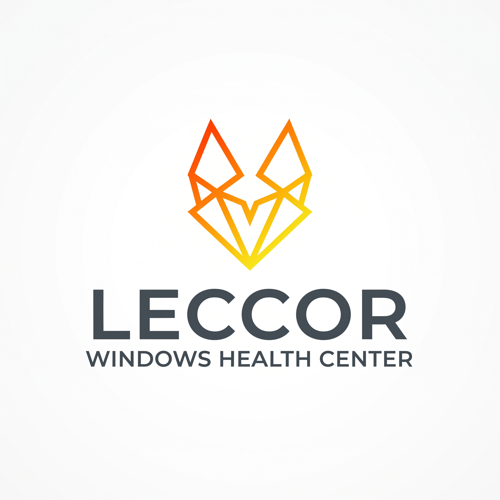

<p align="center">
  
</p>

# Leccor Windows Health Center

> **Ferramenta desktop profissional de auditoria técnica, diagnóstico preventivo e correção segura para Windows 10 e Windows 11 (x64 e ARM64).**

O **Leccor Windows Health Center** não é um "PC Cleaner" genérico nem promete otimizações milagrosas. O software baseia-se em telemetria determinística, diagnóstico fundamentado e comprovação técnica rigorosa, seguindo o pipeline:

$$\text{MEDIR} \longrightarrow \text{DETECTAR} \longrightarrow \text{COMPROVAR} \longrightarrow \text{EXPLICAR} \longrightarrow \text{CORRIGIR} \longrightarrow \text{VALIDAR} \longrightarrow \text{DESFAZER}$$

Cada achado técnico do sistema responde diretamente às 6 perguntas essenciais:

| Pergunta | Campo no Modelo | Descrição |
| :--- | :--- | :--- |
| **O que aconteceu?** | `Finding.Description` | Descrição clara, técnica e objetiva da inconformidade observada. |
| **Como sabemos disso?** | `Finding.Evidence` | Métricas brutas, consultas WMI, registros e Event IDs com timestamp e unidade. |
| **Qual o impacto?** | `Finding.Impact` | Consequência real no desempenho, na estabilidade ou na segurança do sistema. |
| **Como corrigir?** | `Finding.Recommendation` | Orientação de boas práticas ou procedimento de remediação. |
| **Qual o risco da correção?** | `Finding.RepairRisk` | Classificação do risco (`SAFE`, `LOW`, `MEDIUM`, `HIGH`, `CRITICAL`). |
| **Posso desfazer?** | `Finding.SupportsRollback` | Garantia de backup atômico prévio e capacidade de restauração (Rollback). |

---

## Estado do Projeto

- **Versão:** `1.0.0` (Todos os 10 passos do [PASSOS.md](PASSOS.md) concluídos com 100% de êxito).
- **Módulos / Scanners em Produção:** **18 scanners** ativos e paralelizados com concorrência controlada.
- **Regras de Diagnóstico:** **39 regras** com thresholds justificados contra falsos positivos.
- **Ações Reais de Reparo:** 4 correções automáticas com backup prévio, medição antes/depois e rollback.
- **Qualidade e Testes:** **474 testes automatizados aprovados (100% de sucesso)** — 396 unitários, 46 de integração e 32 de sistema.
- **Compilação:** `-warnaserror --no-incremental` em Debug e Release (0 avisos, 0 erros).

---

## Funcionalidades Principais

### 1. Central de Diagnóstico & Varredura Completa
- Varreduras **Rápida** (~10 s), **Completa** e **Personalizada** com seleção de módulos.
- Cálculo de saúde geral (`HealthScore` 0–100) e classificação semântica com anel de pontuação e cobertura de medição.
- Resumo visual de severidade (Crítico, Alto, Médio, Baixo e Informativo) e card de destaque do **"Problema mais importante"** com atalhos de investigação contextual.

### 2. Módulos de Hardware e Desempenho
- **Hardware:** Inventário de processador, placas-mãe, BIOS, memórias RAM (módulos, velocidade e slots) e placas de vídeo (VRAM real pelo registro).
- **CPU & Memória:** Utilização em tempo real, frequência nominal vs efetiva, fila de threads, commit charge, pool paginado/não paginado e hard faults. Histórico deslizante de fundo de 30 minutos.
- **GPU:** Utilização por motor e VRAM consumida através dos contadores oficiais do Windows Performance Data Helper (PDH).
- **Gerenciador de Processos:** Navegação em árvore de processos, métricas de CPU, memória privada, E/S de disco e rede, linha de comando completa, verificação Authenticode e proteção ativa contra encerramento de binários críticos do sistema.

### 3. Armazenamento e Integridade do Sistema
- **Discos Físicos & Volumes:** Estado SMART, tipo de mídia (NVMe, SSD, HDD), suporte a TRIM, saúde física e temperatura.
- **Análise de Espaço Navegável:** Varredura sob demanda de maiores pastas e arquivos com paralelismo controlado por tipo de mídia, sem seguir junções e sem tocar em arquivos locais da nuvem.
- **Limpeza Segura (Safe Cleaner):** Auditoria de temporários com categorização de risco estrita: *Seguro (Safe)* (> 24h), *Revisar (Review)* (caches de navegadores e downloads antigos) e *Avançado (Advanced)* (MEMORY.DMP e WinSxS).
- **Integridade do Windows:** Verificação não destrutiva através de executores dedicados para `DISM /CheckHealth` e `/ScanHealth`, `SFC /VERIFYONLY` e `CHKDSK` somente leitura.
- **Processo Elevado Mínimo (`LeccorWindowsHealthCenter.Elevated.exe`):** Comunicação IPC autenticada por Named Pipe com handshake criptográfico de 256 bits, allowlist estrita e encerramento com validação de PID e horário de início.

### 4. Explorer, Serviços, Drivers, Aplicativos e Rede
- **Windows Explorer:** Auditoria de extensões de Shell registradas (CLSID, DLL e assinatura) e ferramenta de benchmark para detecção determinística de **Pastas Lentas** (> 3.000 arquivos, pastas de rede e provedores em nuvem).
- **Serviços & Drivers:** Catálogo de serviços Windows com identificação de executáveis ausentes (órfãos) e inventário PnP com tradução em português de códigos de falha de hardware (Código 10, 43, 28, etc.).
- **Aplicativos:** Inventário unificado de programas Win32 e pacotes Microsoft Store (UWP/MSIX) com detecção de desinstaladores quebrados e versões duplicadas.
- **Rede & Conectividade:** Teste não invasivo de qualidade de conexão: latência no gateway local, tempo de resposta de resolução DNS, latência para servidores públicos e perda de pacotes.

### 5. Docker, WSL, Ferramentas de Desenvolvimento e Segurança
- **Developer Mode & Ferramentas:** Inventário de runtimes instalados (Node.js, npm, Yarn, pnpm, .NET SDKs, Java/JDK, Maven, Gradle, Python, Git) e IDEs (VS Code, Visual Studio, JetBrains, Android Studio).
- **Docker Desktop & WSL2:** Identificação de engine e backend, medição do tamanho dos discos virtuais `ext4.vhdx` das distribuições Linux (com recomendação de compactação acima de 50 GB) e alerta obrigatório de proteção para volumes de bancos de dados.
- **Análise da Variável PATH:** Contagem de entradas e identificação determinística de caminhos órfãos / inexistentes.
- **Segurança do Windows:** Decodificação de `productState` de antivírus via WMI `SecurityCenter2`, status do Firewall, UAC e auditoria de persistências potencialmente suspeitas (sequestro de IFEO Debugger e `AppInit_DLLs`).
- **Crash Analyzer:** Rastreamento de arquivos de despejo no disco (`Minidump\*.dmp`, `MEMORY.DMP` e `CrashDumps\*.dmp`) e consolidação de eventos dos últimos 30 dias (Application Error 1000, Hang 1002 e BugCheck 1001).

### 6. Motor de Correções, Ponto de Restauração e Rollback
- **Central de Correções (`RepairsView`):** Interface dedicada para simulação (*Dry Run*), criação sob demanda de **Ponto de Restauração nativo do Windows** via WMI e aplicação em lote.
- **Medição Antes/Depois (`IMeasurableRepairAction`):** Comparação numérica absoluta e percentual persistida no histórico do SQLite.
- **Histórico & Rollback:** Histórico de intervenções com botão **[Desfazer]** para restabelecer imediatamente o estado anterior.

### 7. Sistema de Relatórios Avançados (Seções 54 e 55)
Exportação de laudos estruturados da sessão atual ou de varreduras anteriores do SQLite nos seguintes formatos:
- **HTML:** Visual profissional autocontido com CSS moderno, paleta com contraste adequado, responsivo e regras `@media print` para impressão física ou geração em PDF pelo navegador.
- **PDF:** Documento PDF 1.4 padronizado, gerado nativamente com 0 dependências externas, com paginação automática e badges coloridos de severidade.
- **CSV:** Dados tabulares estruturados com codificação UTF-8 com BOM para abertura nativa e perfeita no Microsoft Excel.
- **JSON:** Exportação completa de findings, evidências e métricas.

### 8. Agendamento, Notificações e Persistência
- **Agendamento via Task Scheduler:** Configuração determinística de varreduras periódicas (Diária, Semanal, Mensal ou Manual) utilizando `schtasks.exe`.
- **Execução em Segundo Plano:** Suporte aos argumentos CLI `--scheduled-scan` e `--background-scan` para execução silenciosa sem interface com gravação direta no banco local.
- **Notificações do Windows:** Alertas locais nativos ao concluir varreduras agendadas informando quantidade de problemas e nota de saúde.
- **Persistência no SQLite:** Armazenamento automático e assíncrono das preferências de tema, modo avançado e agendamento na tabela `Configuration`.

---

## Como Executar

### Pré-requisitos
- Sistema Operacional: Windows 10 ou Windows 11 (64-bit / ARM64).
- Runtime / SDK: [.NET 10.0 SDK](https://dotnet.microsoft.com/).

### Execução em Modo de Desenvolvimento
Clone o repositório e execute diretamente via CLI:

```powershell
dotnet run --project src/LeccorWindowsHealthCenter.App
```

### Compilação e Execução de Testes
O script [`scripts/build.ps1`](scripts/build.ps1) executa restore, compilação rigorosa com analisadores como erro e os 474 testes automatizados:

```powershell
./scripts/build.ps1 -Configuration Release
```

### Execução de Varredura Agendada / Segundo Plano
```powershell
./publish/win-x64/LeccorWindowsHealthCenter.exe --scheduled-scan
```

---

## Empacotamento, Instalação e Modo Portable

O projeto conta com automação completa em [`installer/package-installer.ps1`](installer/package-installer.ps1):

### 1. Gerar Binários Self-Contained de Distribuição
```powershell
./installer/package-installer.ps1 -Action Build -Runtime win-x64
```
Para ARM64:
```powershell
./installer/package-installer.ps1 -Action Build -Runtime win-arm64
```
Os executáveis (`LeccorWindowsHealthCenter.exe` e `LeccorWindowsHealthCenter.Elevated.exe`) serão gerados em `publish/<runtime>/`.

### 2. Instalar na Máquina
```powershell
./installer/package-installer.ps1 -Action Install
```
Instala em `%ProgramFiles%\Leccor Windows Health Center` e cria atalho no Menu Iniciar.

### 3. Desinstalar Preservando Dados (Regra de Ouro)
```powershell
./installer/package-installer.ps1 -Action Uninstall
```
> [!IMPORTANT]
> A desinstalação remove os executáveis do aplicativo, mas **preserva intactos** os relatórios técnicos e pontos de restauração em `%ProgramData%\LeccorWindowsHealthCenter`. Para realizar a remoção completa dos dados, utilize a flag `-PurgeUserData`.

### 4. Modo Portable (Seção 61)
Para utilizar como aplicativo portátil (por exemplo, em pendrive de suporte técnico):
1. Copie o conteúdo da pasta `publish/win-x64` para o local desejado.
2. Crie um arquivo vazio chamado `portable.flag` ao lado do executável.
3. O aplicativo armazenará automaticamente o banco SQLite, relatórios e logs em uma subpasta local `data/`.

---

## Princípios de Arquitetura e Segurança

- **Privacidade Total:** 100% local. Absolutamente nenhum dado, telemetria ou evidência é enviado para servidores externos.
- **Menor Privilégio:** O executável principal roda como usuário comum (`asInvoker`). Apenas chamadas estritamente necessárias utilizam o processo auxiliar mínimo elevado com handshake seguro de 256 bits.
- **Rigor Científico:** Sem adivinhações. Se uma informação não possui fonte confiável ou contador disponível, o sistema classifica honestamente como "Não disponível" ou "Sem dados", em vez de inventar números.
- **Separação de Papéis:** O scanner apenas coleta fatos; o `RuleEngine` avalia e gera os achados; o usuário tem sempre a decisão final antes de aplicar qualquer correção.

---

## Mapa da Documentação

| Documento | Descrição |
| :--- | :--- |
| [DOCUMENTACAO.md](DOCUMENTACAO.md) | Documentação técnica central: componentes, camadas, injeção de dependências e banco SQLite. |
| [CONTEXTO.md](CONTEXTO.md) | Estado vivo da solução, histórico detalhado de implementação de cada passo e status atual. |
| [PASSOS.md](PASSOS.md) | Plano de execução original de 10 etapas concluído. |
| [installer/README.md](installer/README.md) | Guia do instalador, opções do Inno Setup e diretrizes do modo portable. |
| [docs/ARCHITECTURE.md](docs/ARCHITECTURE.md) | Detalhamento da arquitetura em camadas e diagrama de fluxo. |
| [docs/SECURITY.md](docs/SECURITY.md) | Modelo de segurança, permissões e comunicação segura entre processos (IPC). |
| [docs/DIAGNOSTICS.md](docs/DIAGNOSTICS.md) | Catálogo de scanners, fontes de dados e limitações documentadas. |
| [docs/RULE_ENGINE.md](docs/RULE_ENGINE.md) | Catálogo das 39 regras de diagnóstico, justificativas de thresholds e prevenção de falso positivo. |
| [docs/REPAIR_ENGINE.md](docs/REPAIR_ENGINE.md) | Motor de correções, análise de risco, backups atômicos, rollback e medição antes/depois. |
| [docs/DEVELOPMENT.md](docs/DEVELOPMENT.md) | Diretrizes para desenvolvimento, boas práticas de código e testes. |

---

<p align="center">
  <sub>Desenvolvido com foco em transparência técnica, segurança e confiabilidade para o ecossistema Windows.</sub>
</p>
